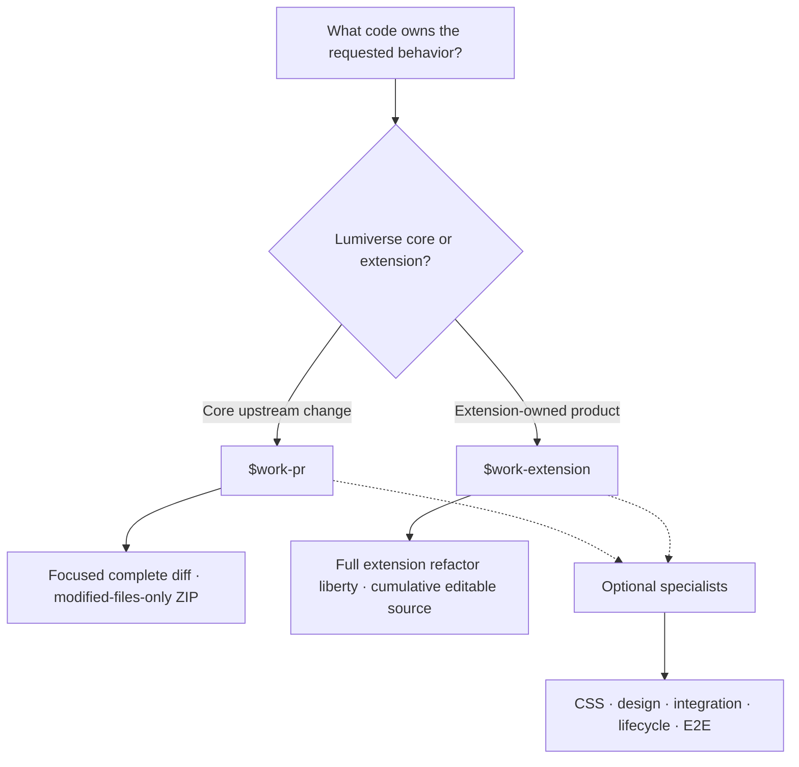

<h1 align="center">✦ Lumiverse · Agent Workflow Kit</h1>

<p align="center">
  <strong>Two ways to build. One rule: understand what you own.</strong><br>
  <em>Reviewable upstream PRs · Full-freedom extensions · UI and runtime verification specialists</em>
</p>

<p align="center">
  
  
  
</p>

<p align="center">
  <a href="#quick-start">Quick start</a> · <a href="#pick-a-workflow">Pick a workflow</a> · <a href="#skills">Skills</a> · <a href="#copyable-prompts">Examples</a> · <a href="#maintainer-notes">Maintainer notes</a>
</p>

> [!IMPORTANT]
> **Core PR ≠ extension ownership.** Upstream Lumiverse changes require controlled, reviewable diffs. A Lumiverse extension is an independently owned product surface with full implementation and visual freedom **inside its boundary**. Git existing in either directory does not choose the mode for you.

## Pick a workflow



| | **`$work-pr` · Lumiverse core** | **`$work-extension` · Lumiverse extension** |
|---|---|---|
| Philosophy | Smallest **complete**, reviewable core change | Best maintainable extension product, not smallest diff |
| Code freedom | Full necessary scope **within the approved PR** | Full refactor/design freedom **within the extension** |
| Host boundaries | Preserve public extension contracts | Use current public host APIs; no silent core edits |
| Git / user state | Strict dirty-tree and branch protection | Preserve user state; repo hygiene still applies |
| ZIP delivery | **Only changed files**, original relative paths | **Full cumulative editable extension source** |
| Testing | Targeted, then appropriate core tests/E2E | Host lifecycle fixture, extension tests and UI/E2E |

### Rules that apply to both

- **No CSS lasagna.** Edit canonical first-party rules and remove superseded selectors. A new `!important` at EOF is not a design strategy.
- **Map before writing.** Use `rg`; trace state, APIs, existing tests and lifecycle. Fail before writes on ambiguous anchors or dirty-file ownership conflicts.
- **Preserve the human's work.** No surprise checkout reset, stash, rebase, branch switch, destructive cleanup, config overwrite, commit or push.
- **Keep Windows diffs clean.** Match with normalized newlines in memory, preserve CRLF/BOM/encoding/final newline when writing.
- **Verify the behavior.** A green build is not proof that the modal, mount lifecycle, mobile controls or backend callbacks work.

## Quick start

Codex discovers repo skills under `.agents/skills/` and user skills under `$HOME/.agents/skills/`. Each skill is a folder containing `SKILL.md`. An optional `agents/openai.yaml` sets display metadata and opt-in behavior. See [OpenAI's skill documentation](https://learn.chatgpt.com/docs/build-skills).

<details open>
<summary><b>Install for one Lumiverse checkout (recommended for a maintainer review)</b></summary>

1. Extract this ZIP **outside** the repository and inspect the `.agents/skills/` folders.
2. Copy selected skill folders to `<Lumiverse repo>/.agents/skills/`.
3. Leave the existing repo `AGENTS.md` alone. Optionally review `AGENTS.example.md` and merge only approved instructions.
4. Restart Codex if the skill selector hasn't refreshed; verify availability via <kbd>/skills</kbd>.

```powershell
# Run inside the Lumiverse checkout, after unpacking this kit somewhere else.
# Replace the path with the unpacked directory. Review name conflicts before copying.
$kit = 'C:\path\to\Lumiverse_Skills_for_Prolix'
New-Item -ItemType Directory -Force '.agents\skills' | Out-Null
Copy-Item "$kit\.agents\skills\*" '.agents\skills\' -Recurse
```

**Maintainer note:** This pack does **not** automatically edit or commit Lumiverse. Installing skills as tracked repo files is a separate maintainer decision. Use a local/global installation first if preferred.

</details>

<details>
<summary><b>Install just for yourself (doesn't modify a repository)</b></summary>

```powershell
$kit = 'C:\path\to\Lumiverse_Skills_for_Prolix'
New-Item -ItemType Directory -Force "$HOME\.agents\skills" | Out-Null
Copy-Item "$kit\.agents\skills\*" "$HOME\.agents\skills\" -Recurse
```

Skills with the same name in more than one location are not automatically merged. Review existing installations before copying. The optional `AGENTS.example.md` can be merged into personal Codex instructions only if you want routing everywhere.

</details>

## Skills

**Primary workflows** (choose one first):

| Skill | When to use |
|---|---|
| [`$work-pr`](.agents/skills/work-pr/SKILL.md) | Live Lumiverse core/upstream contribution; protect checkout and reviewability |
| [`$work-extension`](.agents/skills/work-extension/SKILL.md) | Build, redesign, debug or package an independently owned Lumiverse extension |

**Specialists** (invoke alongside the primary workflow only when needed):

| Engineering / integration | Design / experience | Verification / investigation |
|---|---|---|
| [`$css-refactor`](.agents/skills/css-refactor/SKILL.md) | [`$ui-audit`](.agents/skills/ui-audit/SKILL.md) | [`$runtime-verification`](.agents/skills/runtime-verification/SKILL.md) |
| [`$surgical-ui-fix`](.agents/skills/surgical-ui-fix/SKILL.md) | [`$ui-prototype`](.agents/skills/ui-prototype/SKILL.md) | [`$lumiverse-spindle-diagnostics`](.agents/skills/lumiverse-spindle-diagnostics/SKILL.md) |
| [`$ui-integration`](.agents/skills/ui-integration/SKILL.md) | [`$ui-redesign`](.agents/skills/ui-redesign/SKILL.md) | [`$visual-qa`](.agents/skills/visual-qa/SKILL.md) |
| [`$interaction-states`](.agents/skills/interaction-states/SKILL.md) | [`$responsive-layout`](.agents/skills/responsive-layout/SKILL.md) | [`$repo-investigation`](.agents/skills/repo-investigation/SKILL.md) |
| [`$component-design`](.agents/skills/component-design/SKILL.md) | [`$ui-director`](.agents/skills/ui-director/SKILL.md) | [`$docs-authoring`](.agents/skills/docs-authoring/SKILL.md) |

<details>
<summary><b>What lives inside the kit?</b></summary>

```text
README.md                         GitHub-friendly documentation
AGENTS.example.md                 Optional routing instructions, not an overwrite
.agents/skills/
  work-pr/                         Core PR workflow + deeper Lumiverse review reference
  work-extension/                  Extension ownership + host lifecycle reference
  lumiverse-spindle-diagnostics/   Spindle/Playwright/DOM lifecycle verification
  css-refactor/                    Canonical CSS edits + read-only duplicate scanner
  ui-redesign/                     Structural UI refurbishment
  ui-prototype/                    Interactive design prototypes
  ui-audit/                        Find UI/UX failures
  ui-director/                     Coordinate multi-surface changes
  component-design/                Modals, menus, headers, reusable components
  responsive-layout/               Desktop/mobile adaptation and safe areas
  interaction-states/              State, controls, errors and feedback
  ui-integration/                  Connect existing UI to real services
  visual-qa/                       Breakpoint and screenshot QA
  runtime-verification/            Real behavior, persistence, E2E evidence
  repo-investigation/              Map without modifying source
  surgical-ui-fix/                 Focused bug repair
  docs-authoring/                  Documentation verification
```

</details>

## Copyable prompts

<details open>
<summary><b>Core PR: fix Spindle without expanding the diff</b></summary>

```text
$work-pr $lumiverse-spindle-diagnostics
Fix the reported Spindle regression in Lumiverse core. Inspect the current branch,
remotes and dirty worktree before editing; preserve CRLF and user changes. Use
scripts/e2e-diagnostics when available, and add a minimal mock host regression
fixture for missing/late refs and remount behavior. Transfer only modified PR files
under their exact relative paths. Do not touch unrelated Suite-era code.
```

</details>

<details>
<summary><b>Extension redesign: full freedom, no CSS override mountain</b></summary>

```text
$work-extension $ui-redesign $css-refactor $visual-qa
Rebuild this extension screen rather than patching an unsuitable structure.
You have full architectural and visual liberty within the extension, including
replacing markup, styles and components. Preserve host API contracts, cleanup,
accessibility and persistence. Edit canonical CSS and remove superseded overrides.
Test mount/unmount and responsive layouts; return full cumulative editable
extension source with tests and a manifest. Do not modify Lumiverse core.
```

</details>

<details>
<summary><b>Design review, no writes</b></summary>

```text
$work-extension $ui-audit $repo-investigation
Audit this Lumiverse extension UI and its host integration. Map the design,
state and CSS ownership, enumerate user-visible failures, and propose a design
plan. Read only: do not edit source, change branches, or commit anything.
```

</details>

<details>
<summary><b>Core PR touching visuals</b></summary>

```text
$work-pr $surgical-ui-fix $responsive-layout
Fix the mobile top safe-area regression in Lumiverse core. Locate the canonical
Lumiverse safe-top variable, modify the owning rule and remove any superseded
counter-rules. Check notched mobile/PWA behavior, focus and keyboard controls.
Keep the PR focused, but make the complete fix rather than a CSS band-aid.
```

</details>

## Maintainer notes

- **Maintainer authority comes first.** The sample `AGENTS.example.md` is **not** automatically imposed on any repository. Follow actual `CONTRIBUTING.md`, project-specific instructions and explicit task scope.
- **Suite is historical, not a new foundation.** The PR reference treats Suite remnants as quarantined legacy; it does not prescribe a broad purge.
- **Extension boundary matters.** Full freedom in the extension does not authorize a hidden Lumiverse core edit. If host functionality is missing, propose a separate core API/PR.
- **PR reviewability is an artifact.** A minimal diff can still be wrong or incomplete; a larger diff can be right if it is necessary, bounded, and explained.
- **No credentials in examples, logs or PRs.** Use controlled fixtures for host lifecycle and tests.
- **Skill availability is not execution proof.** Check actual invocations, files changed and test evidence. Every skill has `allow_implicit_invocation: false`, so invoke it by name, e.g. `$work-pr`.

### Sanity-check the kit before installing

```powershell
# From the extracted pack directory
rg --files .agents/skills -g SKILL.md
python .agents/skills/css-refactor/scripts/scan_duplicate_selectors.py path/to/file.css
```

That second command is a **read-only warning scan**, not a full CSS parser and not an autofixer. Repeated selectors can be intentional across differing at-rule scopes.

### Source references

- [Codex skills: structure and installation](https://learn.chatgpt.com/docs/build-skills)
- [GitHub Markdown: callouts, collapsible details and formatting](https://docs.github.com/en/get-started/writing-on-github/getting-started-with-writing-and-formatting-on-github/basic-writing-and-formatting-syntax)
- [Lumiverse repository](https://github.com/prolix-oc/Lumiverse)

---

<div align="center">
<sub>Good PRs are easy to review. Good extensions are free to evolve. Neither needs another CSS override at the bottom of the file.</sub>
</div>
